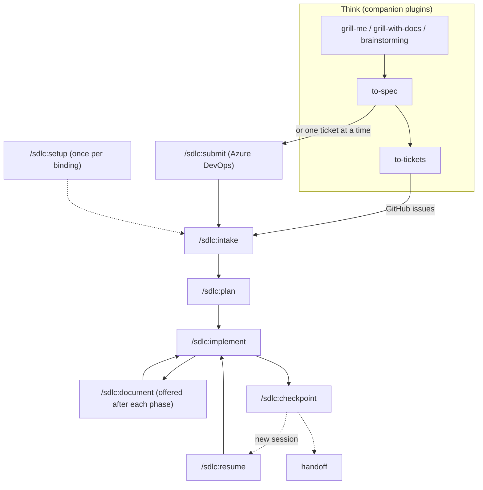

# sdlc

Agentic software development life cycle: intake, plan, implement and document. A Claude Code plugin that mirrors a GitHub issue or an Azure DevOps work item (or adopts a spec, text or an idea) into a local store, then plans, implements, checkpoints and documents it, keeping what a later session needs on disk.

Every skill is explicit-only (`disable-model-invocation: true`): nothing runs unless you type it.

## Skills

| Skill              | Takes                                                                                                                                    | Produces                                                                                                                                                          |
| ------------------ | ---------------------------------------------------------------------------------------------------------------------------------------- | ----------------------------------------------------------------------------------------------------------------------------------------------------------------- |
| `/sdlc:setup`      | A source to bind (an Azure DevOps organization and project, a GitHub owner and repository), defaults, scan roots, or the session context | The config files under the SDLC home; once per binding                                                                                                            |
| `/sdlc:intake`     | A GitHub issue, an Azure DevOps work item, a spec file, pasted text or an idea, or nothing (the current branch's work)                   | A ticket: the upstream mirror under `raw/`, or a local ticket, plus `ticket.json`                                                                                 |
| `/sdlc:plan`       | A ticket reference, or a non-ticket input, and optionally directories                                                                    | `plan.md`: phased, file-level, with test-first phases where a seam allows; re-run to update step status                                                           |
| `/sdlc:implement`  | A ticket and the phases to run (`all`, or a list)                                                                                        | Code changes, built and tested; step status kept in `plan.md`. Never touches a protected branch, never commits unasked                                            |
| `/sdlc:checkpoint` | A ticket and an optional note                                                                                                            | A journal entry (where the code is, what was done and decided, what blocks, the next action), posted as a comment on a remote ticket, and the pull request record |
| `/sdlc:resume`     | A ticket                                                                                                                                 | One read-only briefing ending in the single next action, including what changed upstream                                                                          |
| `/sdlc:submit`     | One ticket to create or edit upstream, with a to-spec or to-tickets body if you have one                                                 | A GitHub issue or Azure DevOps work item, written only after a preview and an explicit yes                                                                        |
| `/sdlc:document`   | A ticket and phase, paths, or `all`                                                                                                      | Edits to the README of each project the change touched; never commits                                                                                             |

## The cycle



1. **Think.** Sharpen the idea with `mattpocock-skills:grill-me`, `mattpocock-skills:grill-with-docs` and/or `superpowers:brainstorming`. Turn the result into a spec with `mattpocock-skills:to-spec`, then into tickets with `mattpocock-skills:to-tickets`.
2. **File.** `to-tickets` publishes to GitHub itself. For Azure DevOps, or to create or change a single ticket, use `/sdlc:submit`, one ticket at a time.
3. **Intake, plan, implement.** `/sdlc:intake`, then `/sdlc:plan`, then `/sdlc:implement`. `implement` offers `/sdlc:document` after each phase.
4. **Stop and come back.** `/sdlc:checkpoint` before attention leaves the ticket; `/sdlc:resume` first thing in a fresh session. On a remote ticket, checkpoint also posts the journal entry as a comment on the issue or work item, always, and nothing else goes upstream ([ADR 0009](docs/adr/0009-a-remote-tickets-journal-lives-upstream.md)). `mattpocock-skills:handoff` compacts a conversation for another agent when a journal entry is not what you need.
5. **Once per binding.** `/sdlc:setup` binds a repository or project to a namespace and product, so `intake` can file what it mirrors.

## How work enters the cycle

- **A to-tickets or to-spec issue on GitHub:** `/sdlc:intake 1234`, `/sdlc:intake acme/billing-app#1234` or the issue URL. Its repository must be bound by `/sdlc:setup`. The same input again refreshes the mirror.
- **An Azure DevOps work item:** `/sdlc:intake 1234` or its URL, with its team project bound.
- **A spec file, pasted text or an idea:** `/sdlc:intake docs/spec.md` or `/sdlc:intake "retry failed invoice exports"`. It becomes a local ticket after one confirmation showing its reference, type and directory; a file's path is kept as `origin`.
- **The current branch:** `/sdlc:intake` with no argument offers a local ticket titled from the branch and asks what the work is. A branch never identifies an existing ticket.
- **Adoption in any skill:** `plan`, `implement`, `checkpoint` and `resume` accept the same non-ticket inputs and adopt them first, as [shared/adoption.md](shared/adoption.md) says.

## Install

```bash
claude plugin marketplace add AlexCR97/.claude
claude plugin install sdlc@alexcr97
```

The marketplace is `alexcr97` ([.claude-plugin/marketplace.json](../.claude-plugin/marketplace.json)) and the plugin is `sdlc`. The scripts need Python as `python` or `python3`, plus `git`, and `gh` or `az` for the sources you use; both CLIs hold the credentials.

## Develop

Load the plugin from a checkout, without installing it:

```bash
claude --plugin-dir path/to/sdlc
claude plugin validate path/to/sdlc
```

Run the tests from the repository root:

```bash
uvx --python 3.14 --with pytest pytest sdlc/tests -q
```

Tests run the `sdlc.py` command line against a scratch `SDLC_HOME`, with `gh` and `az` replaced by launcher stubs; nothing reaches the network.

## Data

Everything lives under the SDLC home, `~/.sdlc` or `$SDLC_HOME`:

```
{namespace}/{product}/{source}/{id}/
    ticket.json  raw/  plan.md  journal/  artifacts/  pulls.md
```

| File                                 | Level       | Holds                                                                                                        |
| ------------------------------------ | ----------- | ------------------------------------------------------------------------------------------------------------ |
| `sdlc.json`                          | the home    | `default_namespace`, `default_source`, `scan_roots`, `protected_branches`, `sensitive`, `worktree_root`      |
| `{namespace}/namespace.json`         | a namespace | the same keys (`default_product` instead of `default_namespace`), and the namespace-level source coordinates |
| `{namespace}/{product}/product.json` | a product   | the same keys and the product-level source coordinates                                                       |
| `…/{id}/ticket.json`                 | a ticket    | its record, keyed as [shared/store.md](shared/store.md) lists                                                |

The inner level wins. [GLOSSARY.md](GLOSSARY.md) defines the terms, [shared/conventions.md](shared/conventions.md) the filing, mirror and path rules, and `/sdlc:setup` the keys. Specific formats sit beside it in [shared/](shared/): [store.md](shared/store.md) (the layout and `ticket.json`), [plan.md](shared/plan.md), [journal.md](shared/journal.md), [artifacts.md](shared/artifacts.md), [guard.md](shared/guard.md), [tdd.md](shared/tdd.md) and [types.md](shared/types.md).

## Scripts

Skills call `python "${CLAUDE_PLUGIN_ROOT}/shared/sdlc.py" <verb>`. There are four verbs, each for work that must come out identical every time:

- `resolve`: report the ticket directory for a reference, or where a new ticket would be filed; read-only.
- `fetch`: mirror an issue or work item into `raw/`; `--check` compares revisions without writing.
- `guard`: answer whether an operation on a repository or branch is allowed under the protected-branch policy.
- `effect`: vet a script's side effects (including a `sensitive` target) before it runs.

[ADR 0006](docs/adr/0006-scripts-and-instructions-are-for-mechanical-work-only.md) explains why there are so few.
