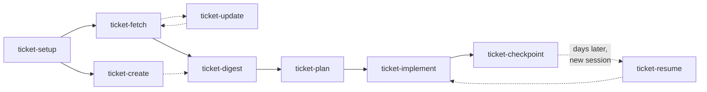

# Ticket Skills — Developer Workflow

## Overview



## Skills

| Skill               | Runs                                                   | Prerequisite     |
| ------------------- | ------------------------------------------------------ | ---------------- |
| `ticket-setup`      | Once per binding, or to create a namespace or product  | None             |
| `ticket-context`    | Optional; once per session, to work in one product     | a product        |
| `ticket-create`     | To create a ticket — locally, or upstream after a yes  | `init`           |
| `ticket-fetch`      | Once per ticket; re-run to refresh the snapshot        | `init`           |
| `ticket-update`     | To change an upstream ticket's fields; re-fetches      | `fetch`          |
| `ticket-digest`     | Once per ticket                                        | `fetch` or `new` |
| `ticket-plan`       | Once to generate; re-run to view/update progress       | a ticket; it fetches and digests what is missing |
| `ticket-implement`  | Once or multiple times; only on a ticket branch        | `plan`           |
| `ticket-checkpoint` | Whenever attention leaves the ticket                   | a ticket on disk |
| `ticket-resume`     | First thing in a new session on an existing ticket     | a ticket on disk |
| `ticket-move`       | To re-file a ticket under another product              | a ticket on disk |

**Two skills write to a system outside this machine** — `ticket-create` creates an upstream ticket, and `ticket-update` changes one. Each has the same load-bearing gate: nothing is written without the user's explicit yes, shown the exact content first.

`fetch` and `digest` each own one output. `plan` and `implement` additionally write any files their research or steps produce along the way. `checkpoint` owns the `journal/` directory outright — it is the only skill that writes it, and `resume` the only one that reads it. `resume` writes nothing at all. See [Data Layout](#data-layout).

## Skills are drivers

No `ticket-*/SKILL.md` contains a field name, a URL, an API version, a credential command, a markup dialect, or a rule that only holds for one kind of work. Each states the workflow and names which file to read. Everything specific lives in one of three places:

| Directory                    | Holds                                                                                                                             | Not a skill   |
| ---------------------------- | --------------------------------------------------------------------------------------------------------------------------------- | ------------- |
| `ticket-common/`             | the resolver `ticket.py`, the git collector, and the shared contracts `RESOLUTION.md`, `ARTIFACTS.md`, `STATUS.md`, `GLOSSARY.md` | no `SKILL.md` |
| `ticket-providers/{source}/` | one directory per ticket source — its manifest, its role files, its code                                                          | no `SKILL.md` |
| `ticket-types/{type}.md`     | one file per kind of work                                                                                                         | no `SKILL.md` |

Both sets are discovered by **glob**, never from a hardcoded list. Adding a source is adding a directory; adding a type is adding a file. Neither changes any `SKILL.md`.

Every driver invokes exactly one command — `ticket-common/ticket.py` — so a skill never has to know which sources exist in order to talk to one.

## Sources

| Role file                                                    | `ado` | `github` | `local` |
| ------------------------------------------------------------ | :---: | :------: | :-----: |
| `provider.json` — capabilities, prefixes, id shape, nouns    |   ✅   |    ✅     |    ✅    |
| `config.md` — what is stored, how the credential is acquired |   ✅   |    ✅     |    ✅    |
| `fetch.md` — how raw data lands on disk                      |   ✅   |    ✅     |    ❌    |
| `new.md` — how a ticket is created here                      |   ✅   |    ✅     |    ✅    |
| `update.md` — how an upstream ticket is changed              |   ✅   |    ✅     |    ❌    |
| `schema.md` — where the content is, and the field map        |   ✅   |    ✅     |    ✅    |
| `types.md` — this source's vocabulary → a canonical type     |   ✅   |    ✅     |    ✅    |
| `links.md` — ticket / comment / attachment URL patterns      |   ✅   |    ✅     |    ✅    |
| `drift.md` — how to tell the local snapshot is stale         |   ✅   |    ✅     |    ✅    |

**The absences are the mechanism, not an oversight.**

`local` has no `fetch.md` and no `update.md`, and its `capabilities.fetch` and `capabilities.update` are `false` — so `/ticket-fetch local:x` and `/ticket-update local:x` refuse, structurally, with no `if source == "local"` anywhere in any driver. There is nothing upstream to fetch from or to change: a local ticket's `raw/ticket.md` *is* the source of truth, and it is edited directly.

A source without a `new.md` or `update.md` is refused the same way, with a reported gap: no skill improvises an API call.

A missing role file is always a **reported gap**, never a licence to substitute another source's.

## Types

The second modular axis. The source decides how to talk to whatever holds the ticket; the **type** decides what shape the work is and what proves it done.

| Type         | Deliverable                  | Done means                                                                                         |
| ------------ | ---------------------------- | -------------------------------------------------------------------------------------------------- |
| `user-story` | shippable behaviour          | the acceptance criteria are demonstrable                                                           |
| `task`       | a bounded change             | the change exists and builds                                                                       |
| `bug`        | a fix plus a regression test | the repro no longer reproduces, and a test covers it                                               |
| `spike`      | **a written finding**        | the question is answered in writing — including when the answer is "no"                            |
| `tech-debt`  | restructuring only           | **behaviour unchanged, structure improved** — the existing tests pass before and after, unmodified |

A ticket's type is resolved once, by its source's `types.md`, and recorded in `ticket.json`, so every later skill agrees without re-deriving it. Any driver accepts `--type` to override. A native type that maps to nothing falls back to `task` and **says so** — never silently.

The two that carry the most weight are `spike` and `tech-debt`, because each inverts a default: a spike that touched no source file is a **complete** run, and a tech-debt run whose tests needed editing to pass is a **failure to report**, not progress.

## Git, branches and worktrees

Skills may run any git or `gh` operation **except one that writes to a protected branch**. The protected branches are the repository's default branch plus any listed in `protected_branches` in the config (which cascades root, namespace, product). One shared guard, reached as `ticket.py guard`, decides — skills ask it rather than restating the rule. The full policy is in [`GUARD.md`](./GUARD.md), and the reasoning in [ADR 0001](../../docs/adr/0001-protected-branches-are-read-and-fast-forward-only.md).

- **`ticket-plan`** fetches, then shows each candidate worktree with its branch and how many commits it is behind the default branch. It offers a new **ticket branch** and **ticket worktree** cut from the up-to-date default branch only when no existing worktree is a current non-protected branch. Planning against an up-to-date `main` worktree changes nothing in it.
- **`ticket-implement`** refuses to start while a workspace worktree has a protected branch checked out, and offers one ticket branch and worktree per repository the phases change. The plan's Workspace section is rewritten to match, with a one-line note saying why.
- **Ticket branches** are named `{prefix}/{id}-{title-slug}` — `feat` for a user story or task, `fix` for a bug, `spike`, `chore` for tech debt — and live in `{repository}/.worktrees/`, or under `worktree_root` when it is configured. The name is a label: no skill infers a ticket from a branch name.
- **Committing and pushing** on a non-protected branch happens only when the developer asks.

## Namespaces and Products

Tickets are kept apart by where the work belongs, not by where they came from. A **namespace** is a body of work that must never mix with another — an employer, a client, personal work. A **product** is one thing inside it that tickets are filed under — EW.Educate, a notes app. Every term is defined in `ticket-common/GLOSSARY.md`.

Each maps onto what the source already has, through a **binding** recorded in the namespace's and product's `config.json`:

| Source   | Namespace                         | Product                 |
| -------- | --------------------------------- | ----------------------- |
| `ado`    | organization                      | project                 |
| `github` | owner — a user or an organization | repository              |
| `local`  | whatever the user names           | whatever the user names |

A product can be bound to several sources or to none: EW.Educate holds its ADO work items and the local tickets written about it side by side, and a side project with nothing upstream is a product with only local tickets.

**Where a new ticket goes** is decided in two steps. First, which products can hold it — a pasted address goes where its coordinates are bound, and a remote ticket needs a product bound to its source. Then, among those, the session context, the invocation directory and the configured default product, in that order. A ticket nothing places lands in a namespace's `default` product, or in `default/default`. Every filing is reported, and `/ticket-move` re-files a ticket at any time.

**`/ticket-context` sets where a session works.** Once set, every skill prefers that product when resolving a reference, files new tickets there, and narrows its ticket listings to it. `/ticket-resume` adopts the resumed ticket's product when nothing is set. It lives in the conversation and nowhere else.

**Config cascades.** The root, namespace and product `config.json` are merged, the inner level winning, so a product records only what differs from its namespace. That is how EdWire plans scan EdWire code and personal plans scan personal code — `scan_roots` set on each namespace — and how bare ids resolve against ADO at work and against another source at home.

## Picking Work Back Up

Work gets put down. An interrupt arrives, the day ends, another ticket takes priority — and the session that held all the context is gone. Two skills exist for that boundary:

- **`ticket-checkpoint`** runs when attention leaves — end of day, an interrupt, a switch to something unrelated. It records the session as a new entry in `journal/`: where the code is, what was done, what was decided **and why**, what is blocking, and the single next action.
- **`ticket-resume`** runs first in the new session. It reads the latest journal entry, `plan.md`, `digest.md` and the prior artifacts, inspects the live git state, checks whether the ticket drifted since it was last fetched, and prints one briefing ending in the next action. It is read-only and starts nothing.

What makes this work is that the two halves record different things. `plan.md` says what state the work is in — that is what the `In Progress` and `Blocked` statuses are for. The journal says *why* it is in that state, which is the half that only exists in a live session and is otherwise lost the moment it ends.

**The journal belongs to these two skills alone.** `checkpoint` is the only writer, `resume` the only reader; `plan` and `implement` never open it. That boundary is deliberate: once `resume` has briefed a session, the journal's contents are already in the conversation, so a later skill re-reading the file would only spend its context on what it already has. The trade is that `checkpoint` has to actually run — it is what converts a session's reasoning into something the next one can read, and nothing else does it.

**The pull request record** is `pulls.md` in the ticket directory: one link per pull request that delivers the ticket, each with its status as of the time the file states. `ticket-checkpoint` and `ticket-implement` record the pull requests a session opens or the user names, discover those on the branches `plan.md`'s Workspace section lists (never by branch name), and refresh every status from its host; `ticket-resume` only reads the file. GitHub and Azure DevOps addresses are both accepted whatever the ticket's source, and a pull request delivering two tickets is in both records. An Azure DevOps status carries its state and reviewers' votes but no checks.

**Neither infers the ticket from the branch name.** Both take the reference or ask, listing what is on disk — the session context's product first, every product on request. A guess that attached a session's journal entry to the wrong ticket would corrupt the one file here that nothing can regenerate, which is also why `checkpoint` asks before writing to a ticket outside the session context.

## Data Layout

Four levels, always: namespace, product, source, ticket.

```txt
~/.tickets/
├── config.json                           {"default_source": "ado", "default_namespace": "edwire"}
├── .credentials/ado/edwire.json          cached token, keyed by organization — never merged, never printed
├── default/default/local/{slug}/         where a ticket nothing places lands
├── edwire/                               namespace ⇄ ADO organization "edwire"
│   ├── config.json                       {"default_product": "ew-educate", "scan_roots": ["C:\\src\\edwire"], "sources": {"ado": {"organization": "edwire"}}}
│   ├── default/                          edwire tickets no product fits
│   └── ew-educate/                       product ⇄ ADO project "EW.Educate"
│       ├── config.json                   {"sources": {"ado": {"project": "EW.Educate"}}}
│       ├── ado/{id}/
│       └── local/{slug}/
│           ├── ticket.json               source, id, title, type, native_type, state, url, last_fetched_at, coordinates
│           ├── digest.md                 ← ticket-digest
│           ├── journal/                  ← ticket-checkpoint only; one file per entry, named by UTC time
│           ├── plan.md                   ← ticket-plan (the index: each step names its artifacts)
│           ├── pulls.md                  ← the pull request record: ticket-checkpoint and ticket-implement
│           ├── raw/                      ← ticket-fetch, or the source of truth for a local store
│           └── artifacts/                ← ticket-plan and ticket-implement
│               ├── planning/             ← research the plan was built on
│               ├── shared/               ← artifacts spanning more than one step
│               ├── step-1.1/             ← probe.js, probe.output.json, README.md
│               └── step-1.3/
└── personal/                             namespace ⇄ GitHub owner
    └── notes-app/                        product ⇄ repository — github/{number}/, local/{slug}/
```

Keeping `{source}/` directly above the id is what keeps ids unique and relative links between sibling tickets working, as long as they are filed together.

`ticket.json` is what keeps source-specific URL patterns out of every driver and every template. A skill reads `ticket.json.url` and **degrades to plain text when it is `null`** — a local store has no web address, and a digest that prints a broken link is worse than one that prints a plain title.

A reference resolves to the nearest ticket directory of that name — in the session context's product, then its namespace, then everywhere. Exactly one at the nearest level wins; **two or more is an error that lists them**, because guessing here attaches work to the wrong ticket. A qualified reference, `{namespace}/{product}/{source}:{id}`, is never ambiguous.

The journal is append-only in the strongest sense in here: an entry is one session's account of itself, and unlike a plan, a digest or a probe output, nothing can regenerate it. Each entry is a file of its own, created and never reopened, so the newest sorts last and a resume reads that one file alone. Each entry carries forward the questions and blockers still open, which is what lets the latest stand without the rest. A correction is a new entry that says what it corrects.

`artifacts/` is created lazily, the first time a run produces a file that is not a change to the workspace — a read-only probe, its captured output, a data extract, or a note recording what was found. A capture is named for the format it holds — `.json`, `.csv`, `.md`, and `.txt` by default — so a later run can parse it instead of re-running the script to get the data in a usable shape.

Each of the two writers owns one part of it. `ticket-plan` writes only to `planning/`, where it stores the research that settles a fact the plan's shape depends on; it runs a script it writes unasked only when `script-check` verifies the script as read-only, and asks before any other. `ticket-implement` writes only to `step-{N}.{M}/` and `shared/`, and reads `planning/` to see why a step is shaped the way it is.

A step directory is named after the `### Step {N}.{M}` heading it belongs to, and the step's `**Artifacts:**` line in `plan.md` points back at it. That back-link is what makes the evidence findable in a later session: `plan.md` is already the first thing `ticket-plan` and `ticket-implement` read, so a step's prior measurements are read before it is re-planned or re-run, rather than being silently re-derived.

Three consequences worth knowing:

- **Renumbering is a rename.** Steps are renumbered whenever the plan's shape calls for it, but a step number is also a directory name, so the same pass renames the directories and updates every reference to the old numbers.
- **Artifacts are append-only.** A measurement taken against a live system is the one thing in here that cannot be regenerated, so a later run writes a new file alongside an existing one rather than replacing it.
- **Only read-only scripts run unasked.** Both skills write script artifacts freely. Each declares `effect: read-only` or `effect: writes` in its header, and `script-check` verifies that header against the code: a verified read-only script runs, and any other, a `cost: heavy` one, or one aimed at a `sensitive` target waits for the user's approval of that run.

## Typical Workflow

```mermaid
flowchart TD
    START([Start]) --> PICKUP{"Picking up a\nticket already\nunderway?"}

    PICKUP -->|Yes| RESUME
    PICKUP -->|"No — new ticket"| INIT_CHECK

    RESUME["/ticket-resume {ref}\n────────────────\nReads latest journal entry + plan.md + digest.md\nInspects live git state\nChecks the source for drift since last fetch\nPrints a briefing ending in the next action\n\nRead-only; starts nothing"]

    RESUME --> RESUME_STALE{"Ticket changed\nwhile away?"}
    RESUME_STALE -->|"Yes — fold it in"| FETCH
    RESUME_STALE -->|No| IMPLEMENT

    INIT_CHECK{"Source\ninitialized?"}

    INIT_CHECK -->|No| INIT
    INIT_CHECK -->|"Yes — skip"| ORIGIN

    INIT["/ticket-setup [source] [--in ns/product]\n────────────────\nBinds a source under a namespace and product\nRuns that source's own connection setup\nSets the default namespace and product\nSaves the default scan roots\n\nRun once per binding"]

    INIT --> ORIGIN{"Does the ticket\nexist upstream?"}

    ORIGIN -->|"Yes — remote source"| FETCH
    ORIGIN -->|"No — my own work"| NEW

    NEW["/ticket-create #quot;title#quot; --type {type}\n────────────────\nLocal: creates raw/ticket.md + ticket.json\nUpstream: shows the proposal, then creates it\nonly on an explicit yes, and fetches it\nSeeds the body from ticket-types/{type}.md"]

    FETCH["/ticket-fetch {ref}\n────────────────\nDownloads the snapshot to raw/\nKeeps attachments already on disk\nRefreshes ticket.json incl. the resolved type\n\nRemote sources only"]

    NEW --> DIGEST
    FETCH --> DIGEST

    DIGEST["/ticket-digest {ref}\n────────────────\nReads raw/ per the source's schema.md\nSurfaces what this type needs\nAnalyzes attachments & related tickets\nWrites digest.md"]

    DIGEST --> PLAN

    PLAN["/ticket-plan {ref}\n────────────────\nFetches and digests whatever is missing\nFetches the code; reports each worktree's staleness\nOffers a ticket worktree if none is current\nDiscovers the workspace from its scan roots:\nrepositories, worktrees & projects\nResearches unknowns → artifacts/planning/\nApplies the type's phase shape & activity mix\nWrites phased plan.md\n\nRe-running shows progress & updates"]

    PLAN --> IMPLEMENT

    IMPLEMENT["/ticket-implement {ref} [phases|all]\n────────────────\nRefuses a protected branch; offers a ticket worktree\nReads plan.md + digest.md + artifacts/\nImplements one, several, or all phases\nProbes, outputs & notes → artifacts/step-N.M/\nBuilds affected projects after each phase\nChecks the type's completion rule\n\nSource-agnostic; never touches the journal"]

    IMPLEMENT --> PHASES_DONE{"All phases\ncomplete?"}
    PHASES_DONE -->|Yes| END([Done])
    PHASES_DONE -->|No| SWITCHING{"Attention leaving\nthis ticket?"}

    SWITCHING -->|"No — keep going"| IMPLEMENT
    SWITCHING -->|Yes| CHECKPOINT

    CHECKPOINT["/ticket-checkpoint {ref}\n────────────────\nRecords the session as a journal entry:\n  · where the code is (repository, worktree, branch)\n  · what was done\n  · what was decided, and why\n  · what is blocking\n  · the single next action\n\nMakes no code changes"]

    CHECKPOINT -.->|"days later,\nnew session"| RESUME
```


